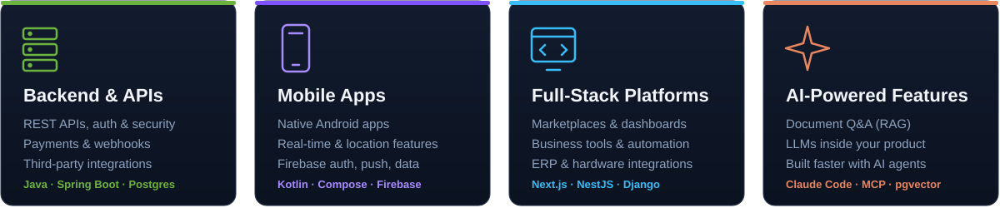

  
  
  
  

---

## 👨‍💻 About me

I'm a developer who likes the unglamorous parts of software: **webhooks that arrive twice, payloads that change shape, payments that must never double-charge.** I build Java backends that handle those cases on purpose — and the Android and web apps that sit on top of them.

- 🎓 B.E. Computer Science, **Chandigarh University** (2025)
- 🏢 Shipped production integrations at **CentAI** and **Xencore Global**
- 🧑‍💼 Freelance: backend, **mobile apps** and full-stack platforms for clients
- 🧠 Sharpening DSA, Java internals & system design
- 📍 India — open to **remote** or **relocation**

---

## 🧩 What I build

---

## 💼 Experience

**SDE Intern — CentAI Technologies** · *Apr 2026 – Oct 2026*
- Built `cent-utility`, a **Spring Boot integration service** connecting LeadSquared CRM, Razorpay and Ringg.ai telephony
- Webhook ingestion + **paginated sync** of leads, activities, tasks and users from the LeadSquared API
- **HMAC-SHA256 signature verification** for Razorpay webhooks
- **Idempotent upserts** guarded on `lastModifiedOn` so retries and out-of-order events can't corrupt data
- Flexible MongoDB schema (`Map<String, Object>` payload pattern) for evolving third-party contracts
- Docker Compose setups for **staging and production**
- Contributed to the Django/DRF/Celery Orders & Payments modules, incl. manual payment capture

**Software Developer — Xencore Global Pvt. Ltd.** · *Oct 2025 – Mar 2026*

**Freelance Developer — Backend · Mobile · Full-Stack** · *Ongoing*
- Take client briefs end to end: **requirements → architecture → quote → delivery**, working directly with founders and business owners
- **Mobile:** native Android apps in Kotlin + Jetpack Compose with Firebase auth, real-time data and push notifications
- **Web platforms:** building a **marketplace for the music & film industry** — talent hiring, equipment listings and an influencer-promotion workflow (Next.js + NestJS)
- **Integrations:** scoping an **ERP-integrated RFID label encoding tool** (Infor LN cloud + Zebra RFID printers) to replace a legacy .NET module
- 📩 Need an app, API or integration built? [Let's talk](mailto:sumitarora.officiall@gmail.com)

---

## 🤖 AI-augmented engineering

I use AI agents as a force multiplier, not a crutch — **I own the design, review every diff, and ship what I understand.**

- **Claude Code & agentic workflows** — multi-step coding, refactors, test generation and codebase exploration with Claude as a pair programmer
- **MCP & tool-using agents** — connecting agents to real tools, repos and data instead of copy-pasting into chat
- **Built my own agent pipeline** — adapted an open-source AI job-search agent to Indian platforms (Naukri, Instahyre, Wellfound), running on Linux
- **LLMs inside products** — RAG with LangChain4j + pgvector in DocSense; prompt design and structured outputs for API workflows

   

---

## 🚀 Featured projects

| Project | What it does | Stack |
|---|---|---|
| **[DocSense](https://github.com/Sumit1arora/DocSense)** | Document Q&A API — upload files, ask questions, get answers grounded in your documents via vector search | Java 21 · Spring Boot · PostgreSQL + pgvector · MongoDB · LangChain4j · Docker |
| **[Journal](https://github.com/Sumit1arora/Journal)** | Secure personal journal backend with stateless auth and per-user data isolation | Spring Boot · Spring Security · JWT · MongoDB |
| **[AssuredGO](https://github.com/Sumit1arora/AssuredGO)** 📱 | Real-time emergency response Android app | Kotlin · Jetpack Compose · Firebase |
| **[Eclipsify](https://github.com/Sumit1arora/Eclipsify)** 📱 | AR-powered educational Android platform | Kotlin · Android · ARCore |

---

## 🛠️ Tech stack

**Backend**

**Mobile & Web**

**Cloud & Tools**

`REST API design` · `Spring Security / JWT` · `Webhooks & idempotency` · `Third-party API integration` · `JPA / Hibernate` · `Jetpack Compose` · `Docker Compose` · `Celery`

---

**Hiring a Java backend engineer, or need an app built?** 
Let's talk → [sumitarora.officiall@gmail.com](mailto:sumitarora.officiall@gmail.com)

